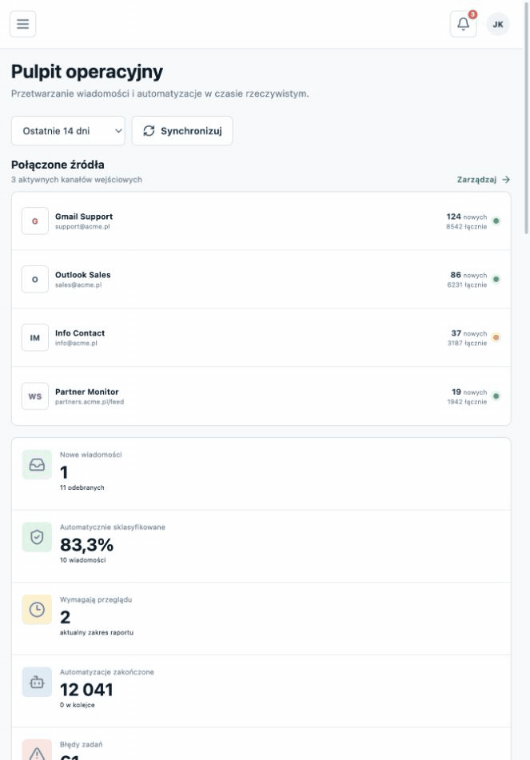
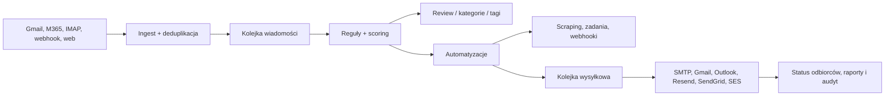

# MailFlow Studio

[](https://github.com/Depal-Jakub/mailflow-studio/actions/workflows/ci.yml)


Wielofirmowa platforma do odbierania, analizowania, klasyfikowania i
automatyzowania wiadomości z wielu źródeł. Łączy pocztę, webhooki i monitoring
stron z wersjonowanymi regułami, kolejkami zadań, wysyłką oraz publicznym API.



## Możliwości

| Obszar | Zakres |
| --- | --- |
| Źródła | Gmail, Microsoft 365, IMAP, webhook, HTML, RSS i sitemap |
| Klasyfikacja | reguły `all/any`, regex, scoring, kategorie, tagi i review |
| Automatyzacje | harmonogram, zdarzenia, opóźnienia, zadania, webhooki i wysyłka |
| Dostarczanie | SMTP, Gmail, Outlook, Resend, SendGrid i Amazon SES |
| Zespół | wiele organizacji, role per firma, granularne uprawnienia i audyt |
| Integracje | klucze API, scope, CIDR, limity, rotacja, logi i OpenAPI 3.1 |
| Operacje | retry, deduplikacja, bezpieczne kolejki i raporty bez limitu 1000 wierszy |

Panel ma osobne, routowalne moduły dla wiadomości, źródeł, kategorii, reguł,
automatyzacji, wysyłki, kont, użytkowników, raportów, audytu, API i ustawień.
Tryb demonstracyjny działa bez bazy, a tryb produkcyjny korzysta z Supabase
Auth, PostgreSQL, Edge Functions i funkcji Netlify.

## Szybki start

Wymagane są Node.js 22+ i npm 10+.

```bash
git clone git@github.com:Depal-Jakub/mailflow-studio.git
cd mailflow-studio
cp .env.example .env.local
npm ci
npm run dev -- --host 127.0.0.1 --port 4173
```

Domyślnie `VITE_DEMO_MODE=true`. Panel jest dostępny pod
`http://127.0.0.1:4173` i zachowuje demonstracyjne zmiany w przeglądarce.

## Wdrożenie produkcyjne

1. Utwórz projekt Supabase i uruchom `supabase db push`.
2. Wdróż pięć Edge Functions opisanych w [instrukcji wdrożenia](docs/SETUP.md).
3. Skonfiguruj sekrety serwerowe i utwórz pierwszego administratora.
4. Połącz repozytorium z Netlify i ustaw zmienne z `.env.example`.
5. Wykonaj [bramkę gotowości produkcyjnej](docs/PRODUCTION_READINESS.md).

Nie da się wiarygodnie potwierdzić OAuth, polityk tenanta, połączenia IMAP,
sandboxu SES ani reputacji domeny bez prawdziwych danych dostawcy. Kod,
migracje i kontrakty są sprawdzane automatycznie; każdy używany provider musi
dodatkowo przejść kontrolowaną próbę na stagingu.

## Publiczne API

Administrator generuje klucz w module **API dla deweloperów**. Pełny sekret
`mfs_live_...` jest pokazywany tylko raz, a baza przechowuje wyłącznie hash
SHA-256.

```bash
curl --fail-with-body \
  -H "Authorization: Bearer $MAILFLOW_API_KEY" \
  "https://APP.netlify.app/v1/me"
```

- interaktywna dokumentacja: `/api-docs.html`;
- specyfikacja: `/openapi.yaml`;
- kolekcja Postman: `/postman_collection.json`;
- przewodnik integratora: [docs/API.md](docs/API.md).

Klucze są przypisane do jednej organizacji i obsługują zakresy, datę
wygaśnięcia, allowlistę IP/CIDR, atomowy rate limit, rotację i dziennik
żądań z `request_id`.

## Architektura



Każdy rekord operacyjny ma `organization_id`. RLS chroni dane organizacji,
Admin API ponownie sprawdza rolę przed użyciem `service_role`, a sekrety
konektorów są szyfrowane AES-256-GCM i przechowywane w schemacie `private`.
Workery przejmują krótkie partie przez `FOR UPDATE SKIP LOCKED`.

## Kontrola jakości

```bash
npm run check
npm audit --audit-level=high
```

`npm run check` wykonuje:

- ESLint i TypeScript;
- testy React, backendu oraz Deno Edge Functions;
- skan wartości przypominających sekrety;
- walidację OpenAPI;
- instalację wszystkich migracji na pustym PostgreSQL;
- test klucza API, limitera, raportów i atomowej kampanii;
- kontrolę składni Netlify Functions i Edge Functions;
- produkcyjny build Vite.

## Dokumentacja

| Dokument | Zawartość |
| --- | --- |
| [SETUP](docs/SETUP.md) | Supabase, Netlify, envy i pierwszy administrator |
| [API](docs/API.md) | klucze, endpointy, idempotencja, limity i przykłady |
| [CONNECTORS](docs/CONNECTORS.md) | wszystkie źródła i konta wysyłkowe |
| [RULES](docs/RULES.md) | warunki, operatory, akcje i automatyzacje |
| [MULTI_TENANCY](docs/MULTI_TENANCY.md) | organizacje, role i izolacja danych |
| [ARCHITECTURE](docs/ARCHITECTURE.md) | przepływ danych, kolejki i skalowanie |
| [OPERATIONS](docs/OPERATIONS.md) | harmonogram, retry, backup i alarmy |
| [SECURITY](docs/SECURITY.md) | sekrety, OAuth, SSRF, webhooki i MFA |
| [PRODUCTION_READINESS](docs/PRODUCTION_READINESS.md) | macierz funkcji i bramka startowa |

## Struktura

```text
src/                    panel React i tryb demonstracyjny
netlify/functions/      Admin API, publiczne API i harmonogramy
supabase/functions/     izolowane workery Edge
supabase/migrations/    schemat, RLS, kolejki i RPC
supabase/tests/         testy logiki Edge
tests/                  testy API i providerów
public/                 OpenAPI, Postman i interaktywne API docs
docs/                   dokumentacja techniczna i operacyjna
```

Projekt jest oprogramowaniem prywatnym. Zgłaszanie błędów i zasady zmian
opisują [CONTRIBUTING.md](CONTRIBUTING.md), a podatności
[SECURITY.md](SECURITY.md).
