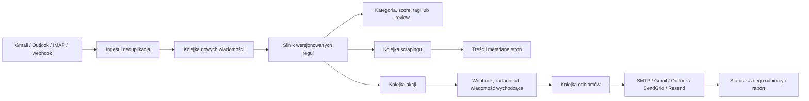

# Architektura MailFlow Studio

## Przepływ danych

## Granice odpowiedzialności

- **Przeglądarka** ma wyłącznie klucz publikowalny Supabase i token zalogowanego
  użytkownika. Nie otrzymuje haseł, refresh tokenów ani `service_role`.
- **Admin API** sprawdza token, organizację i rolę przed każdą operacją. Sekrety
  szyfruje przed zapisaniem ich w prywatnym schemacie.
- **Konektor** pobiera ograniczoną partię wiadomości i zapisuje tylko nowe.
  Cofnięcie okna o godzinę chroni przed lukami, a hash chroni przed duplikatami.
- **Procesor** atomowo przejmuje wiadomości i zapisuje wersję każdej trafionej
  reguły oraz wynik każdego warunku.
- **Workery** wykonują krótkie partie. Błąd jednej akcji nie blokuje pozostałych.
- **PostgreSQL** jest źródłem prawdy dla stanów, liczników i historii.

## Wielofirmowość

Każdy rekord operacyjny ma `organization_id`. Polityki RLS dopuszczają odczyt
członkom organizacji, zapis operatorom, a usuwanie administratorom. Sekrety są
w schemacie `private` i dostępne wyłącznie przez RPC dla roli serwisowej.

## Skalowanie

- Widoki powinny używać paginacji po `received_at, id`, nie pobierać całych tabel.
- Kolejki mają indeksy częściowe tylko dla stanów oczekujących.
- `FOR UPDATE SKIP LOCKED` pozwala uruchamiać kilka workerów bez dublowania pracy.
- Limity partii są sterowane envami i można je zmniejszyć dla planu Netlify.
- Duże załączniki powinny trafiać do Supabase Storage, a w tabeli pozostają
  metadane i wynik ekstrakcji.
